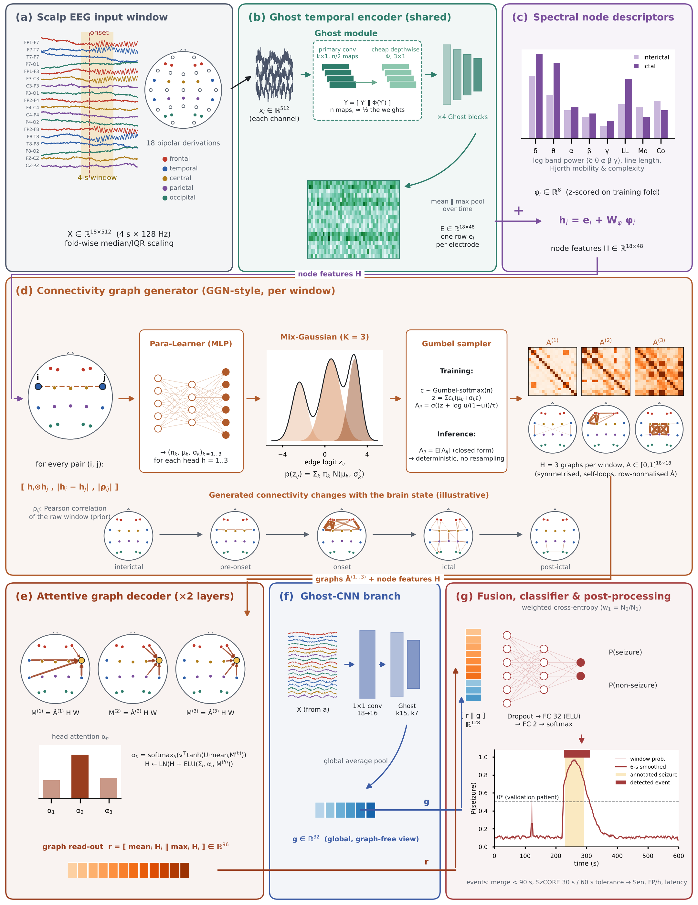

# GhostGraph-Net (GG-Net)

Code and per-patient results for the manuscript

> **GhostGraph-Net: A Lightweight Graph-Generative Network with Ghost Convolutions for Cross-Patient EEG Seizure Detection**
> Md. Humayun Kabir et al. (under review)

GG-Net encodes each scalp-EEG channel with Ghost convolutions, adds interpretable spectral descriptors, and feeds a graph generator adapted from the graph-generative neural network (GGN) of Li et al. (*Sci. Rep.* 12:18998, 2022). For every 4-s window it samples three connectivity graphs from a Gaussian mixture over the edge logits; an attentive graph decoder and a parallel Ghost-CNN branch complete the model (28.0k parameters, 12.3 MFLOPs per window).



## Evaluation protocol

* **Data:** CHB-MIT Scalp EEG Database, patients chb01–chb10; every recording listed as containing a seizure plus the first three seizure-free recordings per patient (80 recordings, 161.7 h, 54 seizures); 18 common bipolar channels, 128 Hz, 4-s windows.
* **Leave-one-subject-out (LOSO):** in each fold one patient is the test patient, the next one (cyclically) is the validation patient and the other eight are used for training. Normalisation statistics, class weights, the training epoch and the decision threshold are taken only from training/validation patients.
* **Scoring:** window-level AUROC/AUPRC/sensitivity/specificity/F1 and SzCORE event-level sensitivity, precision, F1, false positives per hour and detection latency (30 s pre / 60 s post tolerance, events < 90 s apart merged).
* **Models:** GG-Net and seven re-trained baselines (random forest on spectral descriptors, EEGNet-8,2, ShallowConvNet, CNN-LSTM, EEG Transformer, static-graph GCN, re-implemented GGN), two training seeds each, plus four GG-Net ablations (seed 0).

## Main results (mean ± SD over the 10 held-out patients, averaged over two seeds)

| Model | Window AUROC | AUPRC | Seizures detected (seed 0 / 1, of 54) | Event F1 (%) | FP/h |
|---|---|---|---|---|---|
| **GG-Net (proposed)** | 0.935 ± 0.102 | 0.595 ± 0.295 | 44 / 45 | 38.2 ± 33.0 | 3.09 ± 3.93 |
| CNN-LSTM | 0.934 ± 0.116 | 0.602 ± 0.272 | 45 / 42 | 38.7 ± 29.6 | 2.79 ± 3.87 |
| ShallowConvNet | 0.923 ± 0.151 | 0.553 ± 0.298 | 41 / 39 | 38.5 ± 31.8 | 2.26 ± 2.90 |
| EEGNet-8,2 | 0.918 ± 0.151 | 0.542 ± 0.312 | 43 / 41 | 43.5 ± 31.9 | 2.11 ± 3.01 |
| EEG Transformer | 0.907 ± 0.154 | 0.393 ± 0.216 | 43 / 41 | 33.5 ± 31.4 | 4.00 ± 4.67 |
| Static-graph GCN | 0.900 ± 0.155 | 0.517 ± 0.290 | 47 / 43 | 37.5 ± 31.6 | 3.38 ± 3.72 |
| GGN (re-implemented) | 0.898 ± 0.142 | 0.512 ± 0.312 | 49 / 35 | 36.3 ± 28.2 | 2.45 ± 2.81 |
| Random forest (spectral) | 0.889 ± 0.144 | 0.549 ± 0.303 | 32 / 33 | 42.5 ± 33.9 | 1.16 ± 2.10 |

Differences in AUROC (Friedman p = 0.26) and event F1 (p = 0.53) are not significant. Full statistics, the ablation, seed variability and per-patient results are in the manuscript and in `results/summary/`.

## Repository layout

| Path | Content |
|---|---|
| `src/prepare_chbmit.py` | Downloads the CHB-MIT subset from PhysioNet and converts it to compact `.npz` (18 channels, 128 Hz). |
| `src/data.py` | Summary-file parsing, windowing, labelling, spectral descriptors. |
| `src/models.py` | GG-Net, its ablations and all neural baselines. |
| `src/events.py` | Smoothing and SzCORE-style event scoring. |
| `src/run_loso.py` | Leave-one-subject-out training and evaluation (resumable; GPU if available). |
| `src/analyze.py`, `src/ms_numbers.py`, `src/fig4_heat.py`, `src/fig_arch_full.py` | Tables, statistics and figures used in the manuscript. |
| `notebooks/01_full_experiment_colab.ipynb` | One-click Google Colab notebook that reproduces every run. |
| `notebooks/02_resume_runs_colab.ipynb` | Continues an interrupted run on Colab. |
| `results/runs.zip` | Unzip to `results/runs/`. One file set per model × held-out patient × seed (200 runs): `*.json` metrics, `*_pred.npz` window probabilities and labels for every test window, `GG-Net__*__s0_graphs.npz` generated connectivity graphs around each test seizure. |
| `results/summary/all_runs.csv` | One row per run with all metrics. |
| `results/summary/*.json` | Aggregated values, statistics, ablation, complexity and the manuscript tables. |
| `figures/` | Figures 1–4 of the manuscript. |

## Reproducing the results

**Google Colab (recommended):** open `notebooks/01_full_experiment_colab.ipynb` in Colab, select a GPU runtime (*Runtime → Change runtime type → T4 GPU*) and choose *Run all*. Data and results are kept in Google Drive; an interrupted session can be continued with `02_resume_runs_colab.ipynb`. A full run takes about 6–7 GPU hours.

**Local:**

```bash
pip install -r requirements.txt
python src/prepare_chbmit.py --out data/chbmit_prep            # ~3 GB download, ~1 GB stored
python src/run_loso.py --prep data/chbmit_prep --out results_new --epochs 15 --seeds 0,1 \
    --models "GG-Net,GGN (re-impl.),EEGNet,ShallowConvNet,CNN-LSTM,EEG Transformer,Static GCN,RF (handcrafted)"
python src/run_loso.py --prep data/chbmit_prep --out results_new --epochs 15 --seeds 0 \
    --models "GG-Net w/o graph generator,GG-Net w/o Ghost (std conv),GG-Net w/o handcrafted,GG-Net w/o CNN branch"
SEEDS=0,1 python src/ms_numbers.py results_new results_new/summary
```

To recompute the manuscript tables, statistics and Figs. 2–4 from the released outputs without retraining:

```bash
unzip results/runs.zip -d results/
SEEDS=0,1 python src/ms_numbers.py results results/recomputed
```

(The CHB-MIT `chbXX-summary.txt` and `SUBJECT-INFO` files in `results/` are copied unchanged from PhysioNet; they are needed for the seizure annotations.)

## Notes

* Runs were executed on Google Colab, on an NVIDIA T4 GPU or, for some runs, on CPU; the device used is recorded in each run's JSON file. Results are reproducible up to floating-point non-determinism.
* The record list supplied with CHB-MIT names `chb07_18` instead of `chb07_19` as a seizure recording, so one chb07 seizure is not included (54 of 55 seizures).
* The static-graph models (static-graph GCN and the "no graph generator" ablation) use self-loops so that a flat channel cannot produce an undefined graph. The fix only changes windows that contain a completely flat channel; three runs completed before the fix (static-graph GCN chb01 seeds 0 and 1, ablation chb01) contained no such window and are therefore identical.
* The raw EEG is **not** redistributed here. CHB-MIT is available from PhysioNet: <https://physionet.org/content/chbmit/1.0.0/> (A. H. Shoeb, 2009; Goldberger et al., *Circulation* 2000).

## Licence

Code: MIT licence (see `LICENSE`). Result files and figures: CC BY 4.0. CHB-MIT data remain under their PhysioNet licence.

## Citation

If you use this code or these results, please cite the manuscript (citation will be added on publication) and the CHB-MIT database. See `CITATION.cff`.
